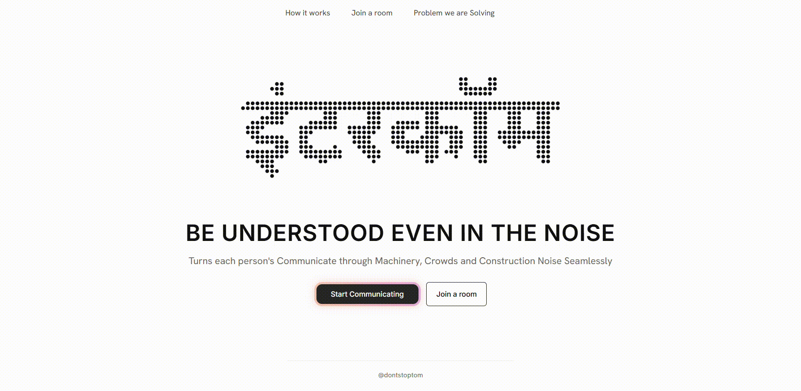
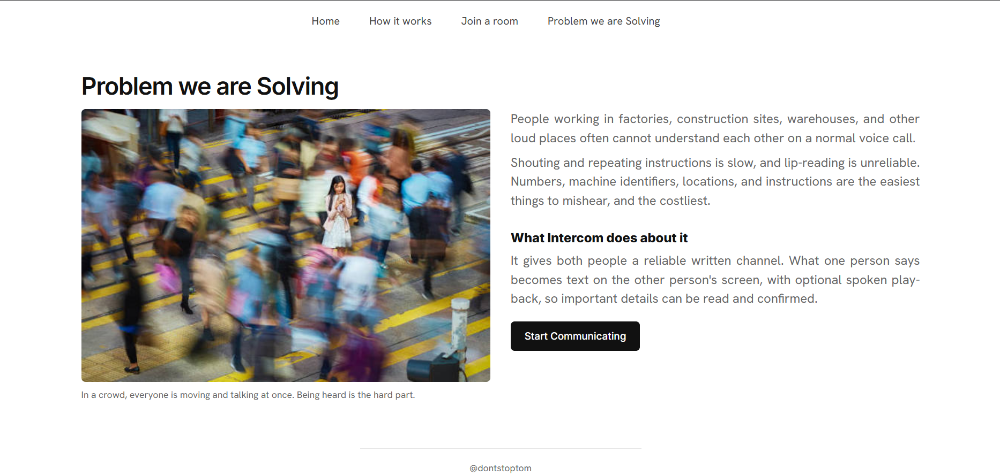
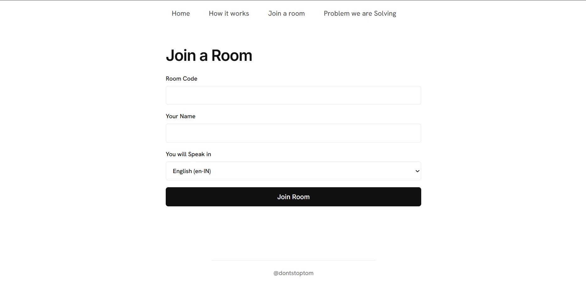

<div align="center">

# INTERCOM | इंटरकॉम

### BE UNDERSTOOD, EVEN IN THE NOISE

Speech → Text → Speech Communication for Factories, Construction Sites, Warehouses and Crowds, powered by **Gnani Prisma** (speech-to-text) and **Gnani Timbre** (text-to-speech).




</div>

---

## The Problem

People working in factories, construction sites, warehouses and other loud places often cannot understand each other on a normal voice call.

Shouting and repeating instructions is slow, and lip-reading is unreliable. Numbers, machine identifiers, locations and instructions are the easiest things to mishear, and the costliest.

<p align="center">
  
</p>

## What Intercom Does

Intercom gives people a **reliable written channel** on top of voice. Two or more people join the same room from separate devices:

1. The first person **speaks**. Their recording is sent to the server.
2. The speech is **transcribed** and appears as readable text on the other person's screen.
3. The other person can **read it, or press play** to hear it as synthesized speech.
4. They reply the same way, which makes a live, two-way conversation with a clear voice, a clear text, a clear message and a clear mission.

> Intercom does **not** translate. The language you choose is the language Gnani transcribes. It is a clarity tool, not a translation tool.

## Screenshots

| Join a room | Problem we are solving |
|:---:|:---:|
|  |  |

## How it works

```
 Person A                      Intercom server                    Person B
┌──────────┐   audio      ┌─────────────────────┐   transcript   ┌──────────┐
│ Hold to  │ ───────────► │  Gnani Prisma (STT) │ ─────────────► │ Reads    │
│ talk     │              │                     │                │ the text │
└──────────┘              │  Gnani Timbre (TTS) │ ◄───────────── │ Taps play│
                          │  (only if enabled)  │   speech audio └──────────┘
                          └─────────────────────┘
```

- **Readable transcripts.** Every message is shown as text first, so a number or machine ID can be read instead of guessed.
- **Spoken playback.** The other person can play the message as synthesized speech. It never plays by itself unless they turn that on.
- **Two-way.** People join one room by code or invite link and reply the same way.
- **Server-side keys.** The Gnani API key stays on the server and is never sent to the browser.

## Features

- Create a room and share a **room code or invite link**
- **Hold to talk** or **tap to start / stop** recording
- Speech-to-text in **10 Indian languages**: English, Hindi, Bengali, Gujarati, Kannada, Malayalam, Marathi, Punjabi, Tamil, Telugu
- Optional **text-to-speech playback** with **13 selectable voices**
- Optional **auto-play** of incoming speech, plus a volume control
- **Microphone selector**, recording timer and live level meter
- **Typed corrections and follow-ups** when a transcript is wrong
- Live presence and connection status through WebSockets
- Per-client **rate limiting** and upload size limits
- Built-in **diagnostics page** that reports real request results, nothing simulated
- **Mock provider** for development without an API key
- Animated dot-matrix wordmark in multiple Indian scripts

## Tech stack

| Layer | Technology |
|---|---|
| Server | Node.js, Express, TypeScript (run with `tsx`) |
| Realtime | Socket.IO |
| Uploads | Multer |
| Validation | Zod |
| Speech AI | Gnani Prisma (STT) and Gnani Timbre (TTS) |
| Frontend | Vanilla JavaScript (ES modules), HTML, CSS |
| Testing | Vitest |

## Getting Started

### Prerequisites

- Node.js 20 or newer
- A Gnani API key

### Install and Run

```bash
git clone https://github.com/<your-username>/intercom.git
cd intercom/clearsignal

npm install
cp .env.example .env      # then add your GNANI_API_KEY
npm start                 # http://localhost:3000
```

### Other scripts

```bash
npm run dev          # restart on file changes
npm test             # adapter tests and a two-user room flow (mock provider)
npm run typecheck    # TypeScript check
```

### No API key yet?

```bash
GNANI_MOCK=1 npm start
```

This runs a clearly labelled **MOCK** provider. No network calls are made and messages are tagged `MOCK`.

### Trying it with two devices

1. Open `http://localhost:3000` and click **Start Communicating**.
2. Create a room and copy the invite link.
3. Open the link in another browser, or on a phone.

> Phones need **HTTPS** for microphone access. Use a tunnel such as `ngrok http 3000`, or deploy the app. `localhost` is exempt on desktop.

## Configuration

Copy `.env.example` to `.env`. These values are read on the server only.

| Variable | Default | Description |
|---|---|---|
| `GNANI_API_KEY` | none | Your Gnani API key (required unless mock mode is on) |
| `GNANI_BASE_URL` | `https://api.vachana.ai` | Gnani API base URL |
| `GNANI_TTS_MODEL` | `timbre-v3.0` | Text-to-speech model |
| `GNANI_TTS_VOICE` | `Shivani` | Default voice |
| `GNANI_TIMEOUT_MS` | `20000` | Timeout for Gnani requests |
| `GNANI_MOCK` | `0` | Set to `1` to use the mock provider |
| `PORT` | `3000` | Server port |

## Project structure

```
clearsignal/
├── server/
│   ├── index.ts        # Express routes and Socket.IO events
│   ├── gnani.ts        # Gnani Prisma / Timbre adapter (and mock provider)
│   ├── rooms.ts        # In-memory rooms, participants and messages
│   └── config.ts       # Environment config, languages, voices, limits
├── public/
│   ├── index.html      # Single-page app shell and view templates
│   ├── app.js          # Routing, room UI, sockets
│   ├── recorder.js     # Microphone capture
│   ├── wordmark.js     # Dot-matrix animated wordmark
│   ├── styles.css
│   └── gallery/        # Illustrations
├── tests/              # rooms.test.ts, gnani.test.ts
├── docs/               # README images
├── .env.example
└── package.json
```

## API reference

| Method | Endpoint | Purpose |
|---|---|---|
| `GET` | `/api/config` | Languages and voices for the UI |
| `GET` | `/api/status` | Real request statistics (diagnostics) |
| `POST` | `/api/rooms` | Create a room |
| `POST` | `/api/rooms/:code/join` | Join a room |
| `GET` | `/api/rooms/:code/state` | Current room state |
| `POST` | `/api/rooms/:code/leave` | Leave a room |
| `POST` | `/api/rooms/:code/messages/voice` | Upload a recording and get a transcript |
| `POST` | `/api/rooms/:code/messages/text` | Send a typed message |
| `POST` | `/api/rooms/:code/messages/:id/speech` | Generate spoken playback for a message |
| `POST` | `/api/rooms/:code/messages/:id/response` | Respond to a message |
| `GET` | `/api/rooms/:code/audio/:audioId` | Fetch generated audio |

## Privacy and limits

- Recordings are sent to Gnani for processing and are **not stored** by this app.
- Generated speech is held in server memory for **30 minutes**.
- Rooms and messages are held **in memory** only, and are removed after **two idle hours** or when the server restarts.
- The microphone is **only on while you are recording**.
- Limits: recordings up to **3 MB**, typed messages up to **600 characters**, **24 requests per minute**.
- Browser noise suppression is best effort.

> ⚠️ **Transcription can be wrong.** Confirm important instructions. Intercom is **not a certified safety system** and must not be relied on for safety-critical control.

## Known limitations

- No pre-join microphone test screen
- No dedicated noise-reduction stage (only the browser's built-in suppression)
- No browser end-to-end test yet
- No translation between languages
- State is in memory, so it is lost on restart
- Script spellings in the dot wordmark should be reviewed by native speakers (edit `WORDS` in `public/wordmark.js`)

## Visit

for Demo **[INTERCOM](https://intercom-4wwd.onrender.com/)**

## Author

Built by **[@dontstoptom](https://x.com/dontstoptom)** for the Gnani GenAI Hackathon.

---

<div align="center">
<sub>A clear voice. A clear text. A clear message. A clear mission.</sub>
</div>
